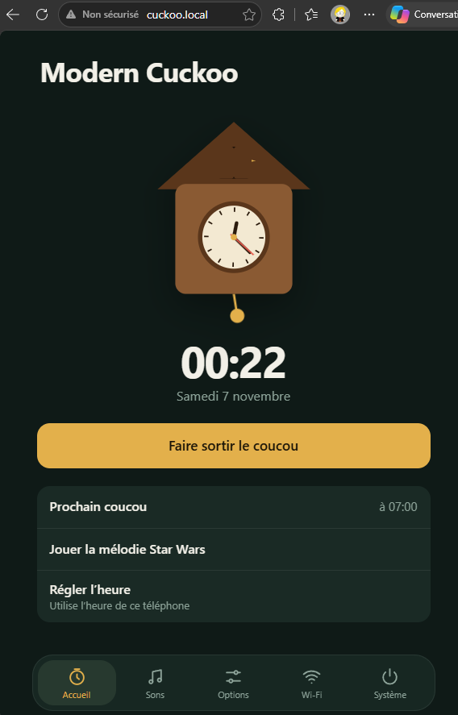
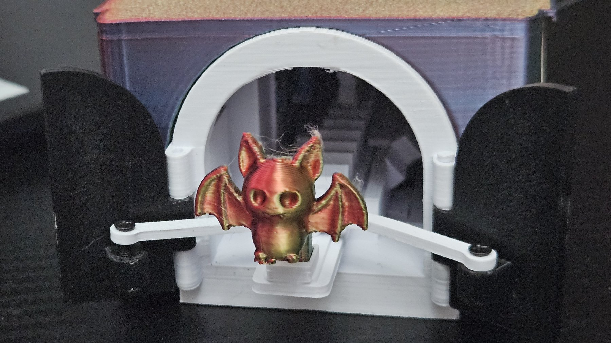
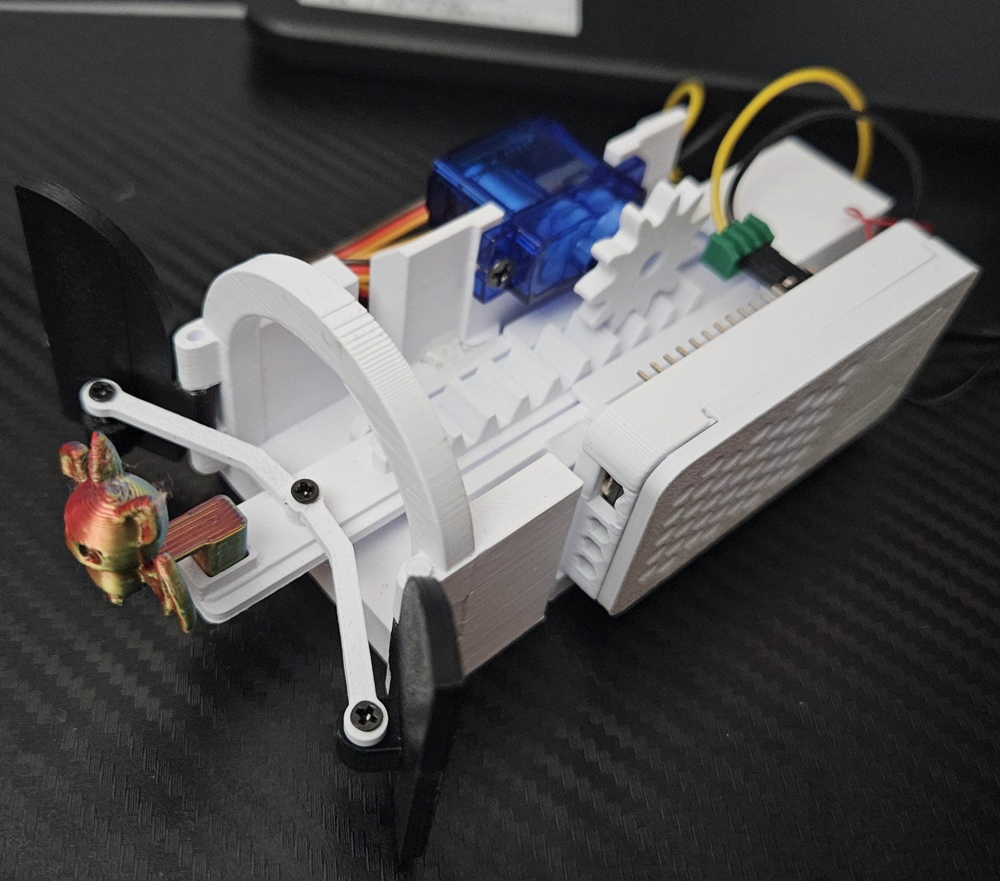

# Modern Cuckoo Clock

**ESP32 · 3D Printed · Wi-Fi Connected** · API & Home Assistant

Modern Cuckoo is a contemporary interpretation of the traditional cuckoo clock. Instead of reproducing a classic wooden clock, this project combines a 3D printed mechanism, an ESP32 running MicroPython, and a modern mobile-friendly web interface.



[](docs/video/cuckoo_out.mp4)

▶ [Watch the demo video](docs/video/cuckoo_out.mp4)

|  |  |
| *The finished cuckoo clock with its decorative cover* | *The assembled mechanism with servo, buzzer and ESP32* |

## Features

- ESP32 and MicroPython
- 3D printed mechanical parts
- A customizable cuckoo figure: print your own
- A configurable sound melody: play your own tone
- A modern, mobile-friendly web interface
- Built-in HTTP API that allows control and monitoring from a web browser, Home Assistant, Node-RED, Jeedom, Python scripts, or any automation platform.
- Automatic time synchronization via Wi-Fi, or standalone mode (AP) without internet


The result is a connected cuckoo clock that can be customized both mechanically and digitally.

## Required parts

- ESP32 (with or without OLED screen). Any ESP32 can be used. I used for this project ESP-WROOM-32 ESP32 0.96
- SG90 servo motor
- Passive buzzer
- USB-C 5 V power source
- Oled SSD1306 is optionnal
- Screws: M2x8 and M2x10
- Dupont cables or wires, with soldering or mechanical connection

## Repository content

```
modern-cuckoo/
├── firmware/
│   ├── main.py
│   ├── boot.py
│   ├── config.json
│   ├── secrets.example.py   # copy to secrets.py and edit
│   ├── index.html
│   └── ssd1306.py
├── 3d-files/
│   └── Modern Cuckoo V5.3mf
├── docs/
│   ├── Modern_Cuckoo_Setup.docx
│   └── images/
├── LICENSE
└── README.md
```

## Quick start

The full illustrated assembly guide is in [`docs/Modern_Cuckoo_Setup.docx`](docs/Modern_Cuckoo_Setup.docx). Summary:

1. **Print** the parts from `3d-files/Modern Cuckoo V5.3mf` using PLA+ or PETG. Start with plate 01 (the mechanism).
2. **Assemble** the mechanism: doors, linkage (1 × M2x8 screw, do not overtighten), rack, then the SG90 servo (2 × M2x8 or M2x10 screws) with the buzzer under it.
3. **Wire** the electronics (see below).
4. **Install MicroPython** on your ESP32: <https://docs.micropython.org/en/latest/esp32/tutorial/intro.html>
5. **Upload** the files from `firmware/` to the ESP32: `main.py`, `config.json`, `secrets.py`, `index.html`, `ssd1306.py`.
6. **Test** by connecting the ESP32 over USB (not the main power). You should hear the cuckoo sound, see messages in the serial console, and be able to open the web interface.
7. **Connect** the external USB-C power supply. The cuckoo should synchronize time, move automatically, play sounds and respond to the web interface.

## Wiring

> **Important:** the ESP32 cannot supply enough current to power an SG90 servo reliably. The servo must be powered directly from the external 5 V power supply.

| From           | To                                      |
|----------------|-----------------------------------------|
| USB-C 5V       | ESP32 5V · Servo +5V                    |
| USB-C GND      | ESP32 GND · Servo GND · Buzzer GND      |
| ESP32 GPIO15   | Servo Signal                            |
| ESP32 GPIO13   | Buzzer S                                |
| ESP32 3V3      | Buzzer +                                |

Notes:

- The 5 V rail can be used with some passive buzzers.
- The on-board USB-C of the ESP32 is only used to upload the Python code and for debugging.
- Do not power the 5 V rail and the on-board ESP32 USB-C at the same time, unless your board supports it.
- With a USB-C cable connected directly to the ESP32, sound and the configuration website work, but the servo will not move due to lack of power.

## Configuration

Hardware pins in `main.py`:

```python
SERVO_PIN = 15
BUZZER_PIN = 13

# Optional OLED display
OLED_SCL = 22
OLED_SDA = 21

OLED_WIDTH = 128
OLED_HEIGHT = 64
```

Wi-Fi can be configured in advance in `secrets.py` (copy `secrets.example.py` and edit it):

```python
SSID = "YourWiFi"
PASSWORD = "YourPassword"
```

> Never commit your real `secrets.py` to a public repository.

## Connecting to the cuckoo

The cuckoo works either through your home internet connection or in AP mode without internet. With internet, the time is set automatically; in AP mode, the time is configured from your phone.

Try both addresses:

- Standard Wi-Fi, through your internet box: <http://cuckoo.local> or http://<LOCAL_IP>
- AP mode: <http://192.168.4.1>

## Optional decorative cover

The decorative outer cover includes a photo slot. Supported image size: **10.5 cm × 4.9 cm**. The lower rails are supplied separately to avoid the need for support material during printing.

## Credits

- **Authors:** Guillaume Anfroy, with the help of my 2 sons for the web design and sound tones. You can reach me through linkedin: https://www.linkedin.com/in/guillaume-anfroy-201418/ or through github issues.
- **Plate 1 (mechanism):** inspired by [DIYhans](https://www.thingiverse.com/thing:5962496) on Thingiverse. Numerous improvements were made to make it smaller and more reliable.
- **Plate 4 (cuckoo figures):** come from numerous sources, such as the [Halloween figure set on MakerWorld](https://makerworld.com/fr/models/3347130-halloween-figure-set-collection-3d-mini-figures#profileId-3803575). These figures are not included in this repository.
- **`ssd1306.py`:** OLED driver for MicroPython, written by its respective authors and subject to their license.

## License

This project is licensed under a **Standard Digital File License**: you may build one for yourself, but you may not share, sell or redistribute the files or derivatives. See [LICENSE](LICENSE) for the full text. Contact me for any commercial use.

## Version

1.0 · November 2026

## HTTP API

**Base URL:** `http://cuckoo.local` or `http://<LOCAL_IP>`

### Endpoints

| Endpoint | Description |
|-----------|-------------|
| `/coucou` | Play the cuckoo |
| `/starwars` | Play the Star Wars melody |
| `/cuckoo_out` | Bring the cuckoo out |
| `/cuckoo_in` | Bring the cuckoo back in |
| `/status` | Get current status and statistics |
| `/config` | Get current configuration |
| `/set` | Update settings |
| `/test` | Test a custom melody |
| `/setwifi` | Update Wi‑Fi credentials |
| `/settime` | Synchronize time |
| `/timer` | Manage timer |
| `/reboot` | Reboot the ESP32 |

### Examples

```text
/coucou
/status
/reboot
/timer?min=10
/set?volume=800&half=1
/test?b1=262&b2=294&b3=330&b4=392&volume=800

### Example Status Response

```json
{
  "time":"21:37",
  "temp":22,
  "hum":58,
  "cpu":41,
  "rssi":-63,
  "up":9523,
  "total":12543,
  "distance_km":1.25
}
```

### Home Automation

Compatible with:

- Home Assistant
- Node-RED
- Jeedom
- Python scripts
- Mobile apps
- Any HTTP client

Example:

```yaml
rest_command:
  cuckoo:
    url: "http://cuckoo.local/coucou"
```

This allows the Modern Cuckoo to be easily integrated into virtually any smart home system.